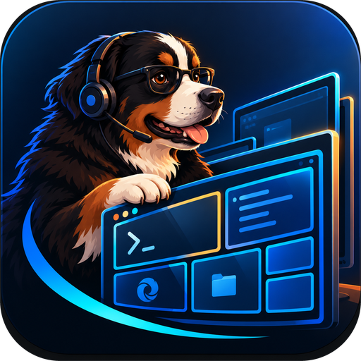
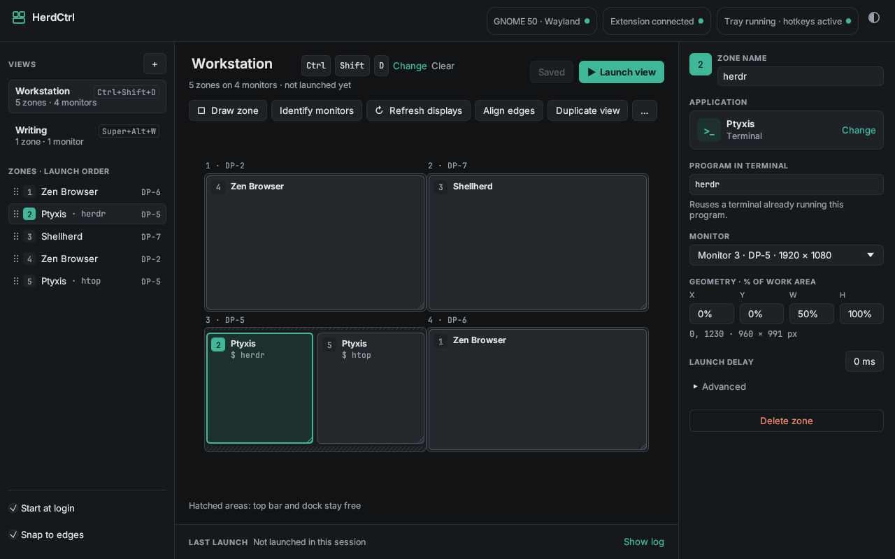
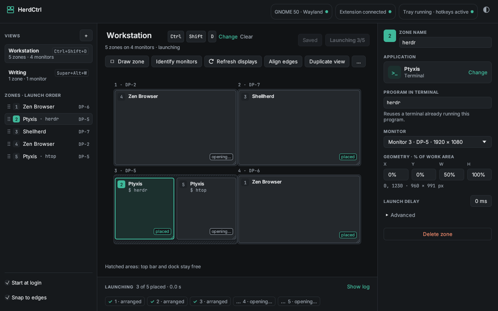
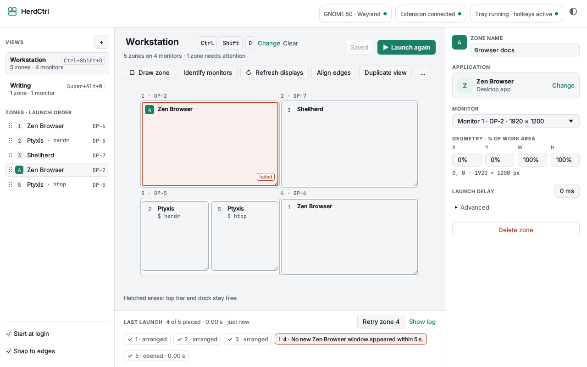
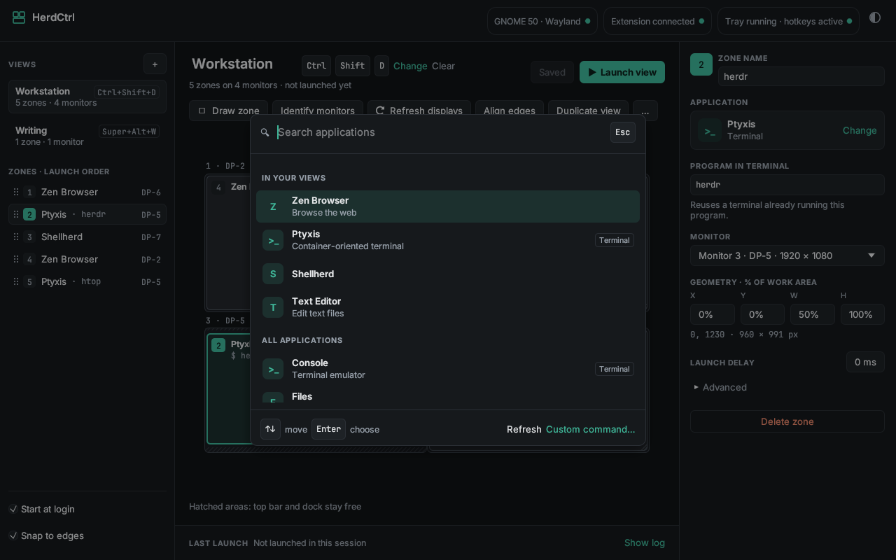
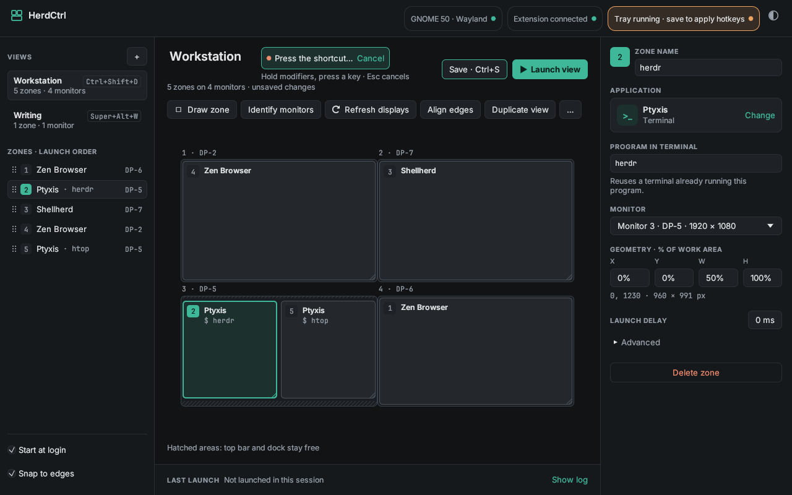
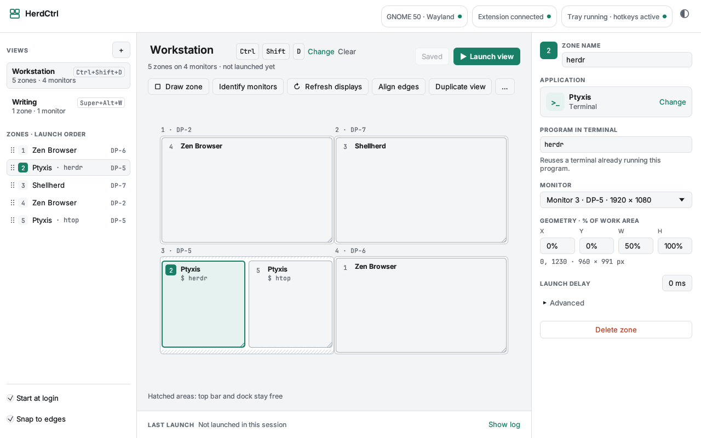
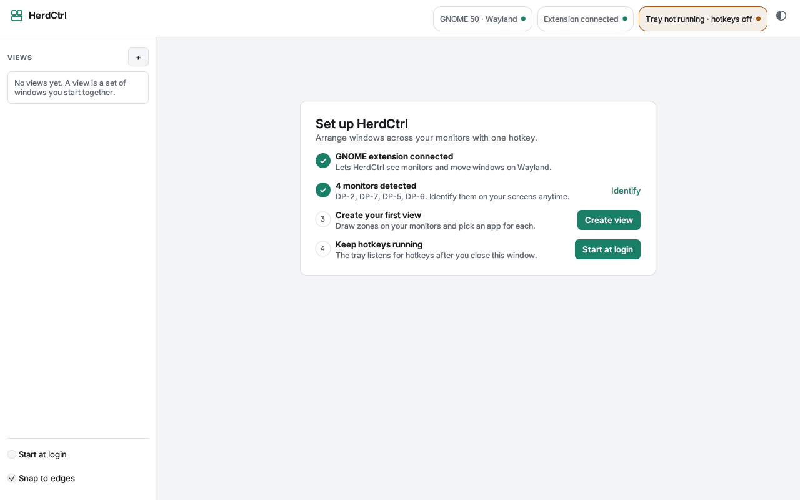

<div align="center">



# HerdCtrl

**Draw zones on your monitors, assign an app to each, and herd every window into place with one hotkey.**

[](https://github.com/pelmenipower/HerdCtrl/actions/workflows/ci.yml)


[User guide (English)](docs/manual.md) · [Handbuch (German)](docs/handbuch.md) · [Changelog](CHANGELOG.en.md) · [Änderungen (German)](CHANGELOG.md) · [Measurements](VALIDATION.md) · [Product spec](PRD.md)

</div>

<p align="center">
  
</p>

HerdCtrl is a small native Linux app for people who open the same window setup every day: browsers, editors and terminals running specific programs, spread over several monitors. You draw the setup once as a **view**. A click or a global hotkey then starts what is missing and moves every window into its zone. Windows that are already open are reused.

It is written in Rust with `egui`, has no Electron or Node.js runtime, and keeps its configuration in one readable JSON file.

## Features

- **Visual zone editor:** draw zones on a true-to-scale preview of all monitors, then move, resize and drag them onto another monitor. Snapping docks zones to borders, halves, thirds, quarters and neighbouring zones without overlaps.
- **Applications, not command lines:** pick any installed desktop app from a searchable list. Apps you already use come first, terminals are marked, and **Custom command…** remains available.
- **Terminal programs:** run `herdr`, `htop` or any other program inside your terminal (Ptyxis, GNOME Terminal, Console, Ghostty, kitty and more). Repeated launches reuse the running session.
- **Reuses open windows:** an open window of the right app is moved instead of starting a second one. Several zones with the same app each get their own window, and HerdCtrl never guesses from window titles.
- **Global hotkeys from a tiny tray process:** `herdctrl --tray` owns the hotkeys and shows a tray menu with every view. It needs about 2 MB of its own memory, keeps running after you close the editor, and can start at login.
- **Live launch feedback:** each zone shows *opening…*, *placed* or *failed*. **Retry zone** repeats only the zones that failed, and errors from the tray arrive as desktop notifications.
- **Respects panels and docks:** on GNOME, zones fill each monitor's work area, so the top bar and a fixed dock stay visible.
- **Multi-monitor aware:** negative offsets, mixed resolutions and scaling. **Identify monitors** shows the matching number on every screen.
- **Dark, light or system appearance:** Inter and JetBrains Mono are embedded, and the system setting is read from the XDG settings portal.

## Screenshots

These images are rendered from the real editor code with fixed sample data, not from a live desktop, so they contain no personal windows or paths. [How to reproduce them](docs/images/README.md).

<table>
  <tr>
    <td width="50%"></td>
    <td width="50%"></td>
  </tr>
  <tr>
    <td align="center"><sub>Live progress per zone while a view launches</sub></td>
    <td align="center"><sub>A failed zone is marked and can be retried on its own</sub></td>
  </tr>
  <tr>
    <td width="50%"></td>
    <td width="50%"></td>
  </tr>
  <tr>
    <td align="center"><sub>Pick an installed app with the keyboard or mouse</sub></td>
    <td align="center"><sub>Record a global hotkey by pressing the whole combination</sub></td>
  </tr>
  <tr>
    <td width="50%"></td>
    <td width="50%"></td>
  </tr>
  <tr>
    <td align="center"><sub>Light theme</sub></td>
    <td align="center"><sub>First start walks through the setup</sub></td>
  </tr>
</table>

## Supported desktops

| Session | Status |
|---|---|
| Ubuntu **X11** with an EWMH window manager | Supported. Uses `xrandr` and `wmctrl`. |
| **GNOME 50 on Wayland** | Supported with the bundled HerdCtrl Shell extension. Native Wayland and XWayland windows. |
| Other Wayland compositors (KDE, Hyprland, Sway, …) | Not supported. HerdCtrl says so instead of silently trying. |

## Install from source

Signed x86_64 builds for Ubuntu 24.04 or newer are on the [Releases page](https://github.com/pelmenipower/HerdCtrl/releases); the [user guide](docs/manual.md#verify-a-download) explains how to verify them. To build it yourself, use a stable Rust toolchain ([rustup](https://rustup.rs)):

```sh
sudo apt-get install build-essential pkg-config libx11-dev libxi-dev libxcursor-dev \
  libxrandr-dev libxkbcommon-dev libxkbcommon-x11-0 libxcb-xkb1 libgl1-mesa-dev \
  libvulkan1 mesa-vulkan-drivers wmctrl x11-xserver-utils
git clone https://github.com/pelmenipower/HerdCtrl.git
cd HerdCtrl
cargo build --release --locked
./target/release/herdctrl
```

On **GNOME 50 / Wayland**, install the Shell extension once, log out and back in, then enable it:

```sh
bash scripts/install-gnome-extension.sh
gnome-extensions enable herdctrl@herdctrl.local
```

The top bar of the editor should then show **GNOME 50 · Wayland** and **Extension connected**. On GNOME, the tray icon needs the AppIndicator extension, which Ubuntu enables by default. More details are in the [user guide](docs/manual.md#installation).

## Quick start

1. Start `herdctrl`. The first-start card checks the extension and your monitors.
2. Click **Create view**, then **Draw zone**, and drag a rectangle on a monitor.
3. Pick an app. For a terminal, also enter the **Program in terminal**, for example `herdr`.
4. Click **Record** next to the view name and press a combination such as Super+Alt+D.
5. **Save** (Ctrl+S) and press your hotkey, or click **Launch view**.

The tray keeps listening for the hotkey after you close the editor. Turn on **Start at login** to have it ready after every login.

## Measured footprint

| Target (PRD) | Measured | |
|---|---|---|
| Binary < 15 MB | 9.2 MB release binary | ✅ |
| Warm start < 100 ms | 30 ms to a visible editor window (median of 5, three series, GNOME 50) | ✅, measured to window visibility, not first frame |
| RAM < 30 MB | Editor: 28.8 or 30.5 MB VmRSS with the Vulkan renderer on an Intel GPU, depending on the start (was 77 MB). Tray: 8.7 MB VmRSS | ⚠️ borderline: met in some starts only; AMD and NVIDIA not measured |

The editor draws with Vulkan and loads only the driver of your GPU, which avoids the roughly 40 MB LLVM library that Mesa's OpenGL driver pulls in. The remaining 1.8 MB difference between starts is a command-buffer pool inside Intel's Vulkan driver whose size depends on start-up timing. Without a usable Vulkan device it falls back to OpenGL by itself (about 85 MB). On AMD GPUs the Vulkan driver links LLVM too, so the saving is smaller there. How these numbers were taken is in [VALIDATION.md](VALIDATION.md).

## Development

```sh
cargo fmt --check
cargo clippy --all-targets --locked -- -D warnings
cargo test --locked
cargo build --release --locked
```

Contributors and coding agents follow [AGENTS.md](AGENTS.md) (rules) and [PRD.md](PRD.md) (product spec). The [user guide](docs/manual.md#development) explains the integration tests on X11 and GNOME, the UI snapshots and the memory measurement. Pull requests go to `staging`; `main` only receives merges from `staging`.

## License

HerdCtrl is released under the [MIT License](LICENSE). The interface uses Inter and JetBrains Mono under the SIL Open Font License 1.1 (license texts in `assets/fonts`).
