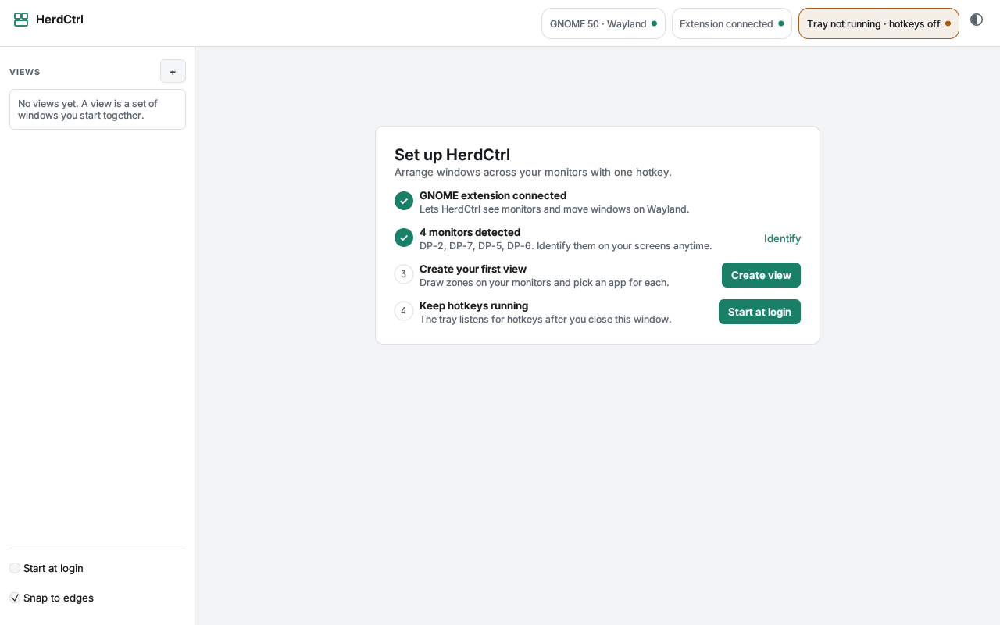
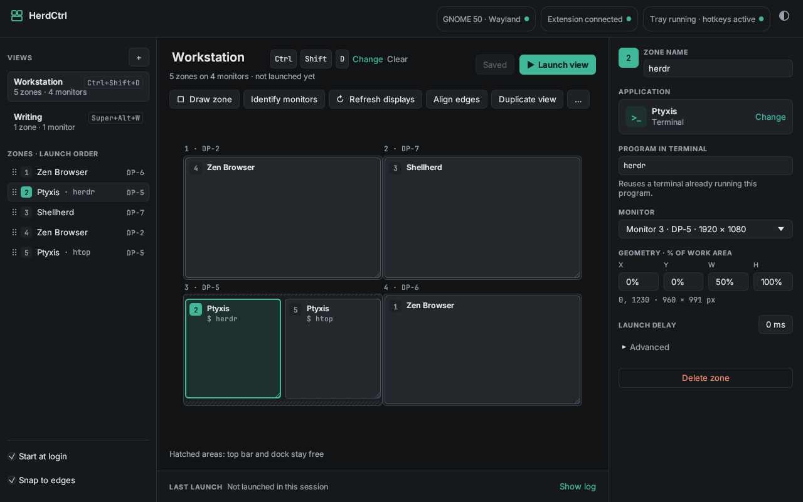
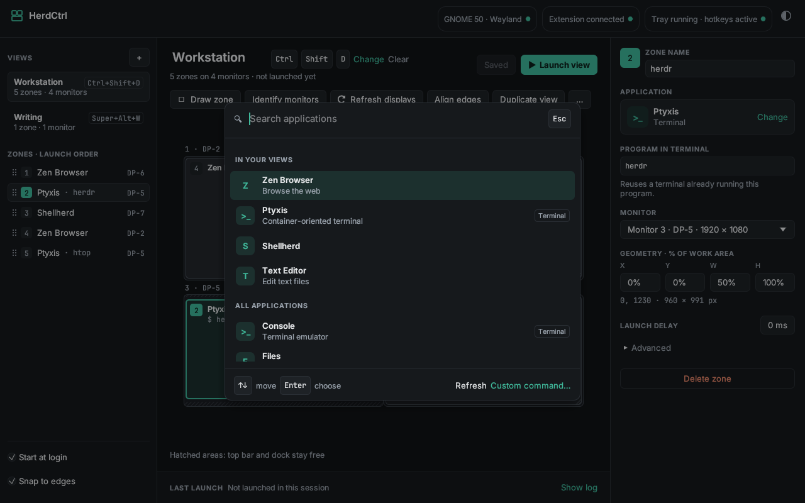
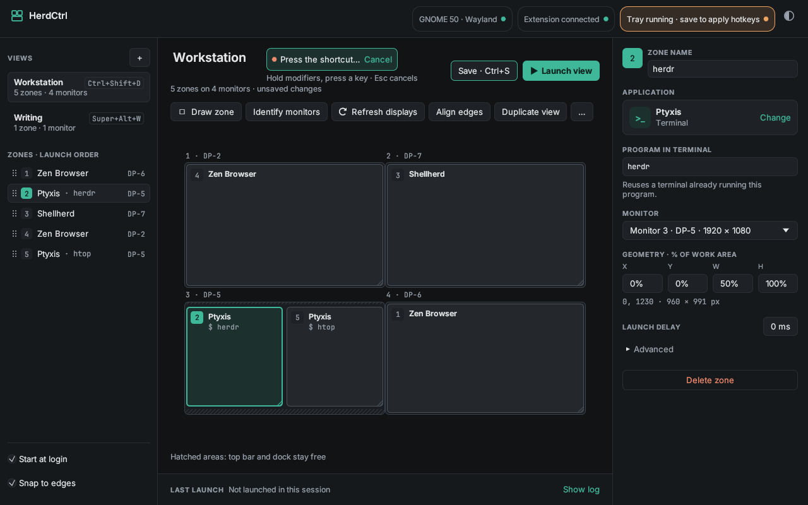
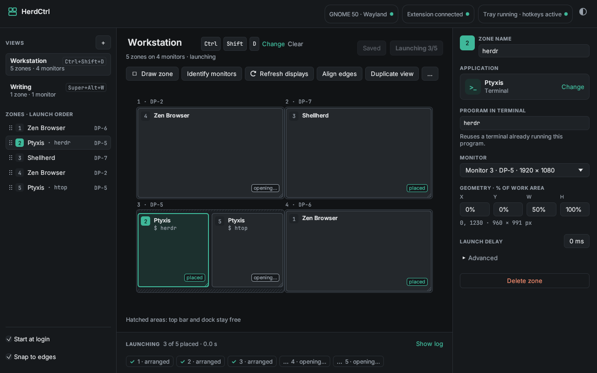
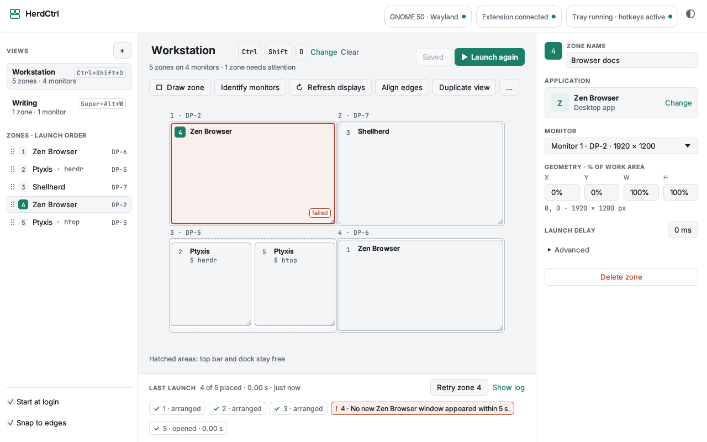
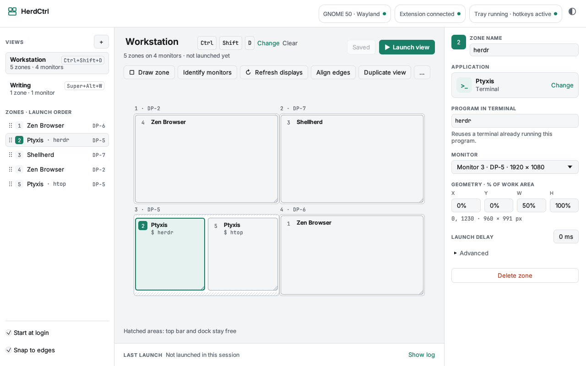

# HerdCtrl – Handbuch


Ausführliche Beschreibung von HerdCtrl. Der Kurzüberblick steht in der [README](../README.md). English version: [manual.md](manual.md).

HerdCtrl ordnet Programmfenster in benannten **Views** an. Eine View besteht aus **Zonen**, die du auf deine Monitore zeichnest. Jede Zone enthält eine Anwendung, ein Programm im Terminal oder einen eigenen Befehl. Startest du eine View per Knopf, Tray-Menü oder globalem Hotkey, öffnet HerdCtrl, was fehlt, und schiebt jedes Fenster in seine Zone.

Die Oberfläche ist englisch. Bedienelemente stehen hier mit ihrem Namen in der App, zum Beispiel **Launch view**.

- [Installation](#installation)
- [Erster Start](#erster-start)
- [Der Editor](#der-editor)
- [Views](#views)
- [Zonen](#zonen)
- [Anwendungen, Terminals und Befehle](#anwendungen-terminals-und-befehle)
- [Monitore](#monitore)
- [Globale Hotkeys](#globale-hotkeys)
- [Eine View starten](#eine-view-starten)
- [Tray](#tray)
- [Darstellung](#darstellung)
- [Dateien](#dateien)
- [Grenzen](#grenzen)
- [Fehlerbehebung](#fehlerbehebung)
- [Entwicklung](#entwicklung)

## Installation

### Unterstützte Sitzungen

| Sitzung | Fenstersteuerung | Monitordaten | Hotkeys |
|---|---|---|---|
| Ubuntu **X11**, EWMH-Fenstermanager | `wmctrl` | `xrandr --verbose` | X11-Tastengriffe (physische Tastencodes) |
| **GNOME 50 unter Wayland** | HerdCtrl-Shell-Erweiterung (Mutter-API) | Erweiterung: Anschlüsse, logische Rechtecke, Skalierung, Arbeitsbereich | Compositor-Griffe über die Erweiterung (aktuelles Tastaturlayout) |

Andere Wayland-Compositoren erkennt HerdCtrl und meldet sie als **Wayland · unsupported**. Wayland-Fenster steuert HerdCtrl nie über `wmctrl`.

Der Editor selbst läuft über X11 bzw. XWayland. Unter GNOME schränkt das nicht ein, welche Fenster er steuern kann: native Wayland- und XWayland-Fenster gehen beide.

### Renderer

Der Editor zeichnet mit **Vulkan** (wgpu) und lässt den Vulkan-Loader nur den Treiber der **primären GPU** öffnen (die, auf der die Firmware gestartet hat, laut `/sys/class/drm`). So wird LLVM nicht geladen, das der OpenGL-Treiber von Mesa und der Software-Treiber lavapipe brauchen, und der Editor bleibt bei 29 bis 31 statt etwa 85 MB. Auf Laptops mit zusätzlicher dedizierter GPU bleibt diese im Ruhezustand.

- Funktioniert kein Vulkan-Gerät, startet sich der Editor selbst mit **OpenGL** neu und meldet *Vulkan renderer unavailable (…); using OpenGL*. Das passiert in virtuellen Maschinen und auf alten GPUs und kostet einen zusätzlichen Start.
- OpenGL erzwingst du mit `HERDCTRL_RENDERER=glow`. Das hilft auch, wenn das Fenster Darstellungsfehler zeigt oder der Editor nach einem GPU-Reset abstürzt.
- Eine eigene Treiberwahl bleibt unangetastet: `VK_LOADER_DRIVERS_SELECT`, `VK_LOADER_DRIVERS_DISABLE`, `VK_ICD_FILENAMES`, `VK_DRIVER_FILES` oder `VK_ADD_DRIVER_FILES`. Mit `VK_LOADER_DRIVERS_SELECT` lässt du den Editor auf einer anderen GPU zeichnen.
- Die Variablen, die HerdCtrl für sein eigenes Fenster setzt, entfernt es für jedes Programm, das es startet. Deine Anwendungen sehen also wie gewohnt alle Treiber.
- Die Monitornummern bei **Identify monitors** nutzen immer OpenGL, sie sind nur wenige Sekunden offen.

### Bauen

Installiere eine stabile Rust-Toolchain mit [rustup](https://rustup.rs), dann:

```sh
sudo apt-get install build-essential pkg-config libx11-dev libxi-dev libxcursor-dev \
  libxrandr-dev libxkbcommon-dev libxkbcommon-x11-0 libxcb-xkb1 libgl1-mesa-dev \
  libvulkan1 mesa-vulkan-drivers wmctrl x11-xserver-utils
cargo build --release --locked
./target/release/herdctrl
```

Heraus kommt eine einzige Programmdatei, `target/release/herdctrl`. Kopiere sie an einen Ort in deinem `PATH` (zum Beispiel `~/.local/bin`), wenn **Start at login** und **Edit layouts…** im Tray auch nach einem Neubau in einem anderen Ordner funktionieren sollen. Beide verwenden den Pfad der laufenden Programmdatei.

Unter X11 braucht HerdCtrl zur Laufzeit `xrandr`, `wmctrl` und GNU `timeout`. Ein Desktop-Eintrag und Icons für das hicolor-Thema liegen in `assets/HerdCtrl-Iconset/linux/`.

### Download prüfen

Fertige x86_64-Dateien für Ubuntu 24.04 oder neuer liegen auf der [Releases-Seite](https://github.com/pelmenipower/HerdCtrl/releases). Das Archiv enthält die Programmdatei `herdctrl`, die Desktop-Dateien und die Lizenz. Installiert sein müssen die Laufzeitpakete aus dem Bau-Befehl oben (ohne die `-dev`-Pakete und den Compiler). Release-Dateien baut und signiert der Workflow `.github/workflows/release.yml` auf GitHub, nie ein Entwicklerrechner. Es gibt keinen gespeicherten Signaturschlüssel: [Sigstore](https://www.sigstore.dev) hält die GitHub-Identität des Workflows in einem öffentlichen Transparenzlog fest. Jedes Release enthält `SHA256SUMS`, dessen Signatur `SHA256SUMS.sigstore.json`, das Programmarchiv und das ZIP der Erweiterung.

Prüfe zuerst die Signatur mit [cosign](https://docs.sigstore.dev/cosign/system_config/installation/), dann die Dateien (`v0.1.0` durch das Release ersetzen):

```sh
cosign verify-blob --bundle SHA256SUMS.sigstore.json \
  --certificate-identity https://github.com/pelmenipower/HerdCtrl/.github/workflows/release.yml@refs/tags/v0.1.0 \
  --certificate-oidc-issuer https://token.actions.githubusercontent.com \
  SHA256SUMS
sha256sum --check --ignore-missing SHA256SUMS
```

Alternativ prüft `gh attestation verify herdctrl-v0.1.0-linux-x86_64.tar.gz --repo pelmenipower/HerdCtrl` die Build-Bescheinigung von GitHub. Linux warnt beim Start nicht vor unsignierten Programmen. Ob ein Download echt ist, zeigen deshalb nur diese Prüfungen. Windows-Versionen und deren Codesignatur gibt es noch nicht.

### GNOME-50-Erweiterung

Unter GNOME/Wayland spricht HerdCtrl über den Session-D-Bus mit seiner eigenen Shell-Erweiterung. Installiere sie einmal aus dem Repository:

```sh
bash scripts/install-gnome-extension.sh
```

Das nutzt GNOMEs eigenen Installer für deinen Benutzer. Kennt GNOME die Erweiterung noch nicht, melde dich ab und wieder an, dann:

```sh
gnome-extensions enable herdctrl@herdctrl.local
```

Nach einem Update einer schon geladenen Erweiterung musst du dich wieder ab- und anmelden, denn GNOME lädt Erweiterungscode nur beim Anmelden. Im Editor liest **Refresh displays** die Monitore neu ein. Im Kopf sollte **GNOME 50 · Wayland** und **Extension connected** stehen.

Eine Diagnose, die nichts verändert, zeigt, was die Erweiterung meldet:

```sh
python3 scripts/check-gnome.py
```

Sie braucht `gdbus` (Paket `libglib2.0-bin`). Das ZIP der Erweiterung baut `python3 scripts/package-gnome-extension.py` nach `target/herdctrl@herdctrl.local.shell-extension.zip`.

Ziel ist GNOME 50. Andere GNOME-Versionen müssen eigens geprüft werden.

### Tray-Symbol

Der Tray nutzt das StatusNotifierItem-Protokoll. GNOME zeigt ihn nur mit der AppIndicator-Erweiterung an (`ubuntu-appindicators@ubuntu.com`, unter Ubuntu standardmäßig an). Ohne Tray-Host funktionieren die Hotkeys trotzdem, nur das Symbol fehlt. Es erscheint, sobald ein Host da ist, zum Beispiel nach dem Entsperren.

## Erster Start



Ohne Views zeigt der Editor eine kurze Checkliste:

1. **GNOME extension connected** (nur unter GNOME): ob die Erweiterung antwortet.
2. **Monitors detected**: die Anschlussnamen. **Identify** zeigt ihre Nummern auf den Bildschirmen.
3. **Create your first view**: **Create view** legt eine leere View an.
4. **Keep hotkeys running**: **Start at login** trägt den Tray in den Autostart deiner Sitzung ein.

## Der Editor



| Bereich | Inhalt |
|---|---|
| **Kopf** | Sitzung (`X11`, `GNOME 50 · Wayland`), Zustand der Erweiterung und des Trays. Ein Klick auf die Anzeige eines gestoppten Trays startet ihn. Das runde Symbol rechts wechselt die Darstellung. |
| **Seitenleiste** | Alle Views mit Hotkey, **+** für eine neue View und die Zonen der gewählten View in Startreihenfolge. Darunter **Start at login** und **Snap to edges**. |
| **Arbeitsfläche** | Deine Monitore maßstabsgetreu, mit Nummer und Anschluss darüber. Schraffierte Streifen sind Leisten und Docks, die Zonen frei lassen. |
| **Eigenschaften** | Die gewählte Zone: Name, Anwendung, Programm im Terminal, Monitor, Geometrie, Startverzögerung und **Advanced**. |
| **Last launch** | Ergebnis des letzten Starts je Zone, mit **Retry zone** und **Show log**. |

**Strg+S** speichert. Schließt du den Editor mit ungespeicherten Änderungen, fragt er mit **Save and close**, **Discard** und **Cancel** nach.

Pro Layout-Datei läuft nur ein Editor. Ein zweiter Start von `herdctrl` endet mit *The HerdCtrl editor is already open*.

## Views

- **+** in der Seitenleiste legt eine View an. Den Namen bearbeitest du direkt im Titel.
- **Duplicate view** kopiert die gewählte View ohne Hotkey, weil ein Hotkey nur zu einer View gehören kann.
- **…** → **Delete view** fragt nach. Gelöscht wird beim Speichern.
- Die Zeile unter dem Titel fasst die View zusammen: Zonen, Monitore und Startzustand.

## Zonen

### Zeichnen, verschieben, Größe ändern

1. **Draw zone** wählen und auf einem Monitor ein Rechteck aufziehen. Danach öffnet sich die Anwendungsauswahl.
2. Eine Zone ziehen, um sie zu verschieben. Auf einem anderen Monitor losgelassen, wechselt sie dorthin: Sie behält relative Größe und Anwendung, übernimmt den neuen Monitor und rastet dort in freien Platz ein. Ist das Ziel voll, bleibt sie an der letzten gültigen Stelle. **Escape** während des Ziehens stellt Monitor und Größe wieder her.
3. Die Größe änderst du am Griff unten rechts.
4. In der Seitenleiste ziehst du Zonen in eine andere **Startreihenfolge**. Die Nummer an jeder Zone ist ihre Position darin.

### Einrasten und Überlappungen

**Snap to edges** ist standardmäßig an. Beim Zeichnen, Verschieben und Größenändern rasten Zonen an Bildschirmrändern, Hälften, Dritteln, Vierteln und den Kanten benachbarter Zonen ein, ohne sich zu überlappen. Hilfslinien zeigen, wo eine Zone einrastet.

**Align edges** räumt ungenau platzierte Zonen auf. Überlappende Zonen werden markiert und erklärt statt still umgeschrieben. Sehr volle Layouts brauchen eventuell Handarbeit. Für freie Platzierung schaltest du das Einrasten ab.

### Eigenschaften

| Feld | Bedeutung |
|---|---|
| **Zone name** | Freie Bezeichnung, erscheint im Log und in Benachrichtigungen. |
| **Application** | Die Desktop-Anwendung. **Change** öffnet die Auswahl. |
| **Program in terminal** | Nur bei Terminal-Anwendungen: das Programm darin, zum Beispiel `herdr`. |
| **Monitor** | Zielmonitor mit Nummer, Anschluss und Auflösung. |
| **Geometry** | X, Y, Breite und Höhe in Prozent des **Arbeitsbereichs** des Monitors, darunter die Pixel. |
| **Launch delay** | Millisekunden Wartezeit vor dem Start dieser Zone, für langsame Programme. |
| **Advanced** | **Custom command** und **Run in terminal**. |
| **Delete zone** | Entfernt die Zone aus der View. |

Zonen werden als Anteile (0,0 bis 1,0) ihres Monitors gespeichert und passen sich so an Auflösung und Skalierung an.

## Anwendungen, Terminals und Befehle

### Anwendungsauswahl



Die Auswahl listet die installierten Desktop-Anwendungen deines Benutzers und des Systems mit übersetzten Namen. Anwendungen, die eine deiner Views schon nutzt, stehen oben, und Terminals tragen die Markierung **Terminal**. Tippen sucht, **↑↓** bewegt die Auswahl und **Enter** übernimmt sie. **Refresh** liest die Desktop-Einträge neu ein, und **Custom command…** öffnet stattdessen den erweiterten Bereich der Zone.

Gespeichert werden ID und Name der Anwendung, nicht ihre Befehlszeile. Beim Start ermittelt HerdCtrl die aktuelle Programmdatei aus dem Desktop-Eintrag, damit Updates und verschobene Installationen weiter funktionieren. Ist eine Anwendung deinstalliert, bittet eine Meldung um eine andere.

Anwendungen starten direkt, ohne Shell. Neue Fenster von Ptyxis und GNOME Text Editor startet HerdCtrl mit deren Option für eine eigene Instanz, damit sich die Fenster sicher zuordnen lassen.

### Programme im Terminal

Wähle ein Terminal (zum Beispiel **Ptyxis**) und trage unter **Program in terminal** das Programm ein, etwa `herdr` oder `htop`. HerdCtrl öffnet das Terminal und startet das Programm darin über `sh -c`. Ein späterer Start findet das Terminal, in dem dieses Programm noch läuft, und verschiebt es nur.

### Eigene Befehle

**Advanced → Custom command** führt eine Befehlszeile über `sh -c` mit deinen Benutzerrechten aus. Sie ersetzt die Anwendungsauswahl. Trage nur Befehle ein, denen du vertraust.

- **Run in terminal** startet den Befehl in deinem Standard-Terminal: die Wahl von `xdg-terminal-exec`, sonst das erste installierte aus Ptyxis, GNOME Terminal, Console, Ghostty, Konsole, Alacritty, kitty, WezTerm und foot. Interaktive Programme brauchen das.
- Alternativ nennst du das Terminal selbst, zum Beispiel `xterm -e htop`.
- Bei anderen Programmen hilft eine Option für eine neue Instanz, wenn das Programm sonst nur ein vorhandenes Fenster in den Vordergrund holt.

## Monitore

Die Monitornummern folgen der aktuellen Anordnung, von oben nach unten und von links nach rechts. Die Beschriftung über jeder Vorschau zeigt Nummer und Anschluss. Fährst du mit der Maus darüber, erscheint die Auflösung.

**Identify monitors** zeigt ein paar Sekunden lang eine große Nummer auf jedem Bildschirm. **Hide numbers** blendet sie früher aus. Layouts speichern **Anschlussnamen** (zum Beispiel `DP-5`), keine Nummern. Steckst du Monitore in anderer Reihenfolge ein, wandert eine gespeicherte Zone deshalb nicht auf einen anderen Bildschirm.

**Refresh displays** liest die Monitore neu ein, nachdem du die Anordnung geändert hast.

### Arbeitsbereich

Unter GNOME füllen Zonen den **Arbeitsbereich** jedes Monitors: Obere Leiste und ein festes Dock bleiben sichtbar. Die Arbeitsfläche zeigt die reservierten Streifen schraffiert. Dafür braucht es die Erweiterung vom 2026-11-09 oder neuer (nach dem Update ab- und wieder anmelden). Unter X11 und mit älteren Erweiterungen nutzen Zonen den ganzen Monitor.

### Koordinaten

- **X11:** Geometrie aus `xrandr --verbose`, auch mit negativen Versätzen. Die Arbeitsfläche zeigt den horizontalen XRandR-Transformationsfaktor. Toolkit-Skalierung pro Monitor, ungleichmäßige Transformationen und beliebige Drehungen sind nicht vollständig abgebildet.
- **GNOME:** logische Monitorrechtecke und Skalierung vom Compositor. Die Platzierung nutzt dieselben logischen Koordinaten, ohne noch einmal mit der Skalierung zu multiplizieren. Gespiegelte Anschlüsse teilen sich einen logischen Monitor.
- Ist der Monitor einer Zone getrennt, schlägt sie mit sichtbarem Fehler fehl, statt auf einen anderen Bildschirm auszuweichen.

## Globale Hotkeys



1. Neben dem View-Namen auf **Record** (oder **Change**) klicken.
2. Die ganze Kombination drücken, zum Beispiel **Super+Alt** halten und **D** drücken. Mindestens ein Modifikator (Super, Strg, Alt oder Umschalt) ist nötig.
3. **Save**. Der Tray übernimmt neue Hotkeys nach etwa einer Sekunde. Bis dahin steht im Kopf *save to apply hotkeys*.

**Escape** oder **Cancel** beendet die Aufnahme, ebenso ein Klick in ein Textfeld. Nicht unterstützte Tasten zeigen einen Hinweis. **Clear** entfernt den Hotkey. Gespeichert wird er als Text, zum Beispiel `Super+Alt+KeyD`.

Gut zu wissen:

- egui meldet die Super-Taste unter Linux nicht. Die Aufnahme fragt deshalb den X-Server, ob Super gedrückt ist (der Editor läuft unter X11/XWayland).
- Eine Kombination, die schon der Desktop oder der laufende Tray greift, kommt bei der Aufnahme nie an. Um die aktuelle Kombination einer View neu aufzunehmen, löschst du sie zuerst und speicherst.
- Unter GNOME richten sich Buchstaben nach dem aktuellen Tastaturlayout, unter X11 zählen physische Tastencodes.
- Konflikte mit Kürzeln, die der Desktop schon belegt, kommen als Benachrichtigung.
- GNOME: bis zu 256 Hotkeys. Die Griffe enden, wenn der Tray beendet wird. Nach einem Absturz laufen sie nach etwa 20 Sekunden ab, und das Abschalten der Erweiterung gibt sie sofort frei.

## Eine View starten



**Launch view**, das Tray-Menü und der Hotkey lösen denselben Ablauf aus. Während des Starts zeigt jede Zone auf der Arbeitsfläche *opening…*, *placed* oder *failed*. Die Leiste darunter listet jede Zone:

| Ergebnis | Bedeutung |
|---|---|
| **arranged** | Ein vorhandenes Fenster wurde in die Zone geschoben. |
| **opened** | Ein neues Fenster wurde gestartet und platziert. |
| **failed** | Mit Grund, zum Beispiel *No new Zen Browser window appeared within 5 s.* |



**Retry zone** startet nur die fehlgeschlagenen Zonen neu. **Show log** zeigt alle Meldungen. Startet der Tray eine View, bleiben erfolgreiche Platzierungen still, und Fehler kommen als Desktop-Benachrichtigung.

### Wie Fenster gefunden werden

1. HerdCtrl sucht zuerst ein **offenes Fenster** der Anwendung der Zone. Anwendungen erkennt es an ihrer eigenen Programmdatei oder der Prozessidentität aus dem Desktop-Eintrag, nie am Fenstertitel. Gemeinsam genutzte Interpreter wie `python` allein kennzeichnen keine Anwendung.
2. Gibt es mehrere passende Fenster, nimmt es die niedrigste stabile Fenster-ID, die keine andere Zone dieser View belegt. Wiederholte Starts nutzen deshalb dieselben Fenster.
3. Ist kein freies Fenster da, startet es die Anwendung und wartet auf ein neues Fenster dieses Prozesses oder seiner Kinder. Fenster, die ein schon laufender Prozess derselben Anwendung übernimmt, zählen auch.
4. Läuft eine Anwendung schon, startet HerdCtrl sie über die **Neues-Fenster-Aktion** ihres Desktop-Eintrags, sofern es eine gibt. Ohne diese Aktion holt die Anwendung meist nur ihr Fenster nach vorn, und die Zone meldet, dass kein zweites Fenster erschienen ist.
5. Vor dem Verschieben prüft HerdCtrl die PID des Fensters erneut, damit nie ein fremdes Fenster bewegt wird.

### Zeiten

- Jede Zone wartet ihre **Startverzögerung** ab und dann bis zu **5 Sekunden** auf ihr Fenster. Jeder Hilfsaufruf ist auf 2 Sekunden begrenzt.
- Ein neu geöffnetes Fenster wird 0,25, 0,75 und 1,75 Sekunden nach der ersten Platzierung erneut gesetzt, weil Programme wie Ptyxis (restore-window-size) oder Zen ihre gemerkte Größe erst danach anwenden.
- Alle Zonen derselben Anwendung, auch Terminal-Zonen, starten nacheinander, damit jedes neue Fenster seiner Zone zugeordnet werden kann. Jede kann bis zu ihrer Verzögerung plus 5 Sekunden dauern.
- Ganze View-Starts laufen nacheinander: Zweimal schnell den Hotkey drücken startet nicht alles doppelt.
- Läuft die Positionierung in den Timeout, bleiben die Programme trotzdem offen.

Programme, die sich selbst aktualisieren (die laufende Programmdatei erscheint als *(deleted)*), erkennt HerdCtrl weiter über den Desktop-Eintrag, aus dem sie gestartet wurden.

## Tray

`herdctrl --tray` ist ein kleiner Hintergrundprozess ohne Editorfenster und ohne Renderer. Er hält die globalen Hotkeys und zeigt ein Symbol in der oberen Leiste.

| Menüeintrag | Wirkung |
|---|---|
| *View-Name (Hotkey)* | Startet diese View. |
| **Edit layouts…** | Öffnet den Editor. |
| **Start at login** | Schreibt oder entfernt `~/.config/autostart/herdctrl.desktop`. |
| **Quit HerdCtrl** | Beendet den Tray und gibt die Hotkeys frei. |

- Der Editor startet beim Öffnen auch den Tray, falls er nicht läuft. Speichern im Editor startet ihn wieder, falls du ihn beendet hattest.
- Der Tray lädt `layouts.json` etwa eine Sekunde nach jeder Änderung neu, auch wenn du die Datei von Hand bearbeitest.
- Pro Layout-Datei läuft nur ein Tray, ein zweiter beendet sich.
- Fehler (fehlgeschlagene Starts, belegte Kürzel, ungültige Konfiguration) erscheinen als Desktop-Benachrichtigungen.

## Darstellung

Das runde Symbol im Kopf wechselt zwischen **System**, **Dark** und **Light**. Mit **System** liest HerdCtrl beim Start die Hell/Dunkel-Einstellung des Desktops aus dem XDG-Settings-Portal. Die Wahl liegt in `~/.config/herdctrl/ui.json`.



## Dateien

| Datei | Inhalt |
|---|---|
| `$XDG_CONFIG_HOME/herdctrl/layouts.json` (Standard `~/.config/herdctrl/layouts.json`) | Alle Views, Zonen und Hotkeys |
| `~/.config/herdctrl/ui.json` | Darstellung |
| `~/.config/autostart/herdctrl.desktop` | Existiert, solange **Start at login** an ist |
| `$XDG_RUNTIME_DIR/herdctrl-{tray,editor}-<hash>.lock` | Sperren für Editor und Tray, ein Paar je Layout-Datei |

### layouts.json

```json
{
  "views": [
    {
      "name": "Workstation",
      "hotkey": "Super+Alt+KeyD",
      "zones": [
        {
          "name": "herdr",
          "monitor": "DP-5",
          "application": { "id": "org.gnome.Ptyxis", "name": "Ptyxis" },
          "terminal_command": "herdr",
          "delay_ms": 0,
          "bounds": { "x": 0.0, "y": 0.0, "width": 0.5, "height": 1.0 }
        },
        {
          "name": "Notizen",
          "monitor": "DP-6",
          "command": "xterm -e vim ~/notizen.md",
          "delay_ms": 500,
          "bounds": { "x": 0.5, "y": 0.0, "width": 0.5, "height": 1.0 }
        }
      ]
    }
  ]
}
```

| Feld | Bedeutung |
|---|---|
| `hotkey` | Leer oder `Modifikator+…+Taste` mit Tastennamen wie `KeyD`, `Digit1` oder `F10` |
| `monitor` | Anschlussname |
| `application` | ID des Desktop-Eintrags und Anzeigename |
| `terminal_command` | Programm in einer Terminal-Anwendung |
| `command` | Eigener Befehl (statt `application`) |
| `run_in_terminal` | `command` im Standard-Terminal ausführen |
| `delay_ms` | Startverzögerung |
| `bounds` | Anteile am Arbeitsbereich des Monitors |

Unbekannte Felder werden abgelehnt. Gespeichert wird über eine private Zwischendatei, die atomar umbenannt wird. Eine ungültige Datei bricht den Start mit Fehlermeldung ab, statt überschrieben zu werden. Liegt nach einer Unterbrechung noch `layouts.json.tmp` herum, prüfst und entfernst du sie vor dem nächsten Speichern.

## Grenzen

- **Speicher:** Der Editor braucht mit dem Vulkan-Renderer 29 bis 31 MB (gemessen mit Intel-GPU; das PRD-Ziel von 30 MB wird nur bei einem Teil der Starts erreicht), nach einem Rückfall auf OpenGL etwa 85 MB. Der proprietäre NVIDIA-Treiber ist nicht gemessen. Auf AMD-GPUs hängt schon der Vulkan-Treiber an LLVM, dort braucht der Editor mehr. Der Tray, der dauerhaft läuft, braucht etwa 2 MB eigenen Speicher. Details in [VALIDATION.md](../VALIDATION.md).
- Wrapper-Skripte, Sandbox-Anwendungen und Terminal-Server, die alle Fenster in einem Prozess führen (GNOME Console, GNOME Terminal), lassen sich nicht immer sicher erkennen. HerdCtrl rät nicht: Es startet ein neues Fenster, ordnet nach Startreihenfolge zu oder meldet einen Timeout.
- Eine Anwendungszone und ein eigener Befehl für **dasselbe Programm** in einer View werden nicht unterstützt, weil sich ihre Fenster nicht sicher unterscheiden lassen.
- Fenstermanager und Programme können Mindestgrößen erzwingen oder Rahmen hinzufügen. Pixelgenaue Außenmaße hängen deshalb vom Desktop ab.
- Sehr kurzlebige Startprozesse können enden, bevor HerdCtrl ihre Kinder sieht.
- Noch nicht geprüft: absolute Fensterursprünge nativer Wayland-Fenster, gebrochene Skalierung und das Ein- und Ausstecken von Monitoren unter GNOME.

## Fehlerbehebung

| Symptom | Abhilfe |
|---|---|
| `Library libxkbcommon-x11.so could not be loaded` | `libxkbcommon-x11-0` und `libxcb-xkb1` installieren. Sie werden auch unter Wayland gebraucht, weil der Editor über XWayland läuft. |
| Kopf zeigt **Displays unavailable** (Grund im Tooltip) | Erweiterung installieren und aktivieren, ab- und wieder anmelden, dann **Refresh displays**. Prüfen mit `python3 scripts/check-gnome.py`. |
| Kopf zeigt **Wayland · unsupported** | Der Compositor ist nicht GNOME 50. Eine X11-Sitzung oder GNOME 50 verwenden. |
| Tray-Symbol fehlt | AppIndicator-Erweiterung aktivieren. Hotkeys funktionieren auch ohne Symbol. |
| Hotkey tut nichts | Tray-Anzeige im Kopf prüfen, nach der Aufnahme speichern und auf eine Konflikt-Benachrichtigung achten. Eventuell belegt der Desktop die Kombination. |
| Eine Zone meldet immer *No new … window appeared* | Die Anwendung holt nur ihr vorhandenes Fenster nach vorn. Ein Fenster je Anwendung verwenden oder einen eigenen Befehl mit Neues-Fenster-Option. |
| Editorfenster bleibt leer, zeigt Darstellungsfehler oder stürzt ab | Mit `HERDCTRL_RENDERER=glow` starten, um OpenGL zu nutzen, und GPU und Treiber melden. |
| Zonen überdecken die obere Leiste | Erweiterung aktualisieren und ab- und wieder anmelden, damit sie den Arbeitsbereich meldet. |

## Entwicklung

Regeln für Mitwirkende und Coding-Agenten stehen in [AGENTS.md](../AGENTS.md) und [CLAUDE.md](../CLAUDE.md). Die Produktanforderungen stehen in [PRD.md](../PRD.md), Messungen und Abnahmen in [VALIDATION.md](../VALIDATION.md). Die Gestaltungsregeln stehen in [design-system.md](design-system.md).

### Prüfungen

```sh
cargo fmt --check
cargo clippy --all-targets --locked -- -D warnings
cargo test --locked
cargo build --release --locked
node scripts/gnome-controller.test.mjs
python3 scripts/package-gnome-extension.py
```

Die CI führt das unter Ubuntu aus, dazu einen Rust↔GJS-Protokolltest auf einem isolierten D-Bus und die X11-Integration unter Xvfb und Openbox. Die Build-Ergebnisse (Programmdatei, Erweiterungs-ZIP, X11-Messung als JSON) werden hochgeladen. Releases veröffentlicht die CI nicht.

### UI-Tests und Screenshots

`cargo test` bedient den Editor über `egui_kittest` mit simulierter Maus und Tastatur, ohne GPU: View anlegen, mit Strg+S speichern, View über das Menü löschen und eine Anwendung mit den Pfeiltasten wählen.

Zwei Tests auf Abruf zeichnen den Editor über einen wgpu-Adapter mit festen Beispieldaten:

```sh
# Alle Hauptzustände, dunkel und hell, nach target/ui-snapshots/
cargo test --locked render_ui_snapshots -- --ignored
# Die Galerie für README und Handbuch in docs/images/
cargo test --locked render_docs_screenshots -- --ignored
```

Sie vergleichen nicht mit gespeicherten Bildern. Sieh dir jedes neu erzeugte Bild an, bevor du es committest. Details in [images/README.md](images/README.md).

### X11-Integration

Auf einem X11-Desktop:

```sh
sudo apt-get install xterm xdotool x11-utils
cargo test --locked x11_ -- --ignored --test-threads=1 --nocapture
cargo build --release --locked
python3 scripts/check-x11.py --output /tmp/herdctrl-x11-acceptance.json
```

Die Rust-Tests öffnen auf jedem Monitor kurzlebige Terminals und vergleichen deren Client-Geometrie (`xwininfo`) mit 32 Pixeln Toleranz. Sie prüfen außerdem, dass ein fremdes Fenster liegen bleibt, dass der Timeout ohne Fenster greift und dass ein getrenntes Ziel abgelehnt wird, bevor etwas startet. Die Python-Prüfung nutzt eine eigene temporäre Konfiguration, drückt `Strg+Alt+Umschalt+F10`, während ein anderes Fenster den Fokus hat, und misst Startzeit und Speicher. Halte dieses Kürzel frei und fass die Testfenster während des Laufs nicht an.

### GNOME-Live-Tests

Auf Abruf in einer echten GNOME-50-Sitzung. Sie brauchen `python3-gi`, `gir1.2-gtk-4.0` und `x11-utils` und lassen gespeicherte Layouts unverändert:

```sh
HERDCTRL_LIVE_GNOME=1 cargo test --locked gnome_live_launch_and_resize_on_each_monitor -- --ignored --nocapture --test-threads=1
cargo build --release --locked
HERDCTRL_LIVE_GNOME=1 cargo test --locked gnome_live_identification_positions_and_cleans_up_labels -- --ignored --nocapture --test-threads=1
```

Der erste öffnet auf jedem Monitor rahmenlose GTK-Testfenster, nativ unter Wayland und unter XWayland, und schreibt `target/gnome-live-acceptance.json`. Der zweite prüft die Monitornummern.

### Speicher und Startzeit messen

```sh
cargo build --release --locked
scripts/measure-rss.sh 5
```

Das Skript startet den Editor mit einer Wegwerf-Konfiguration, wartet auf das Fenster, das zu seiner eigenen PID gehört, und meldet die Zeit bis zum sichtbaren Fenster, VmRSS und RssAnon. `HERDCTRL_RENDERER=glow scripts/measure-rss.sh 5` misst zum Vergleich den OpenGL-Rückfall.

### Icon

Das Fenstersymbol stammt aus `assets/icon.png`, die Quelle ist `assets/icon.svg` (`rsvg-convert -w 256 -h 256 assets/icon.svg -o assets/icon.png`). Das vollständige Icon-Set mit hicolor-Ordnern und Desktop-Eintrag liegt in `assets/HerdCtrl-Iconset/`.
