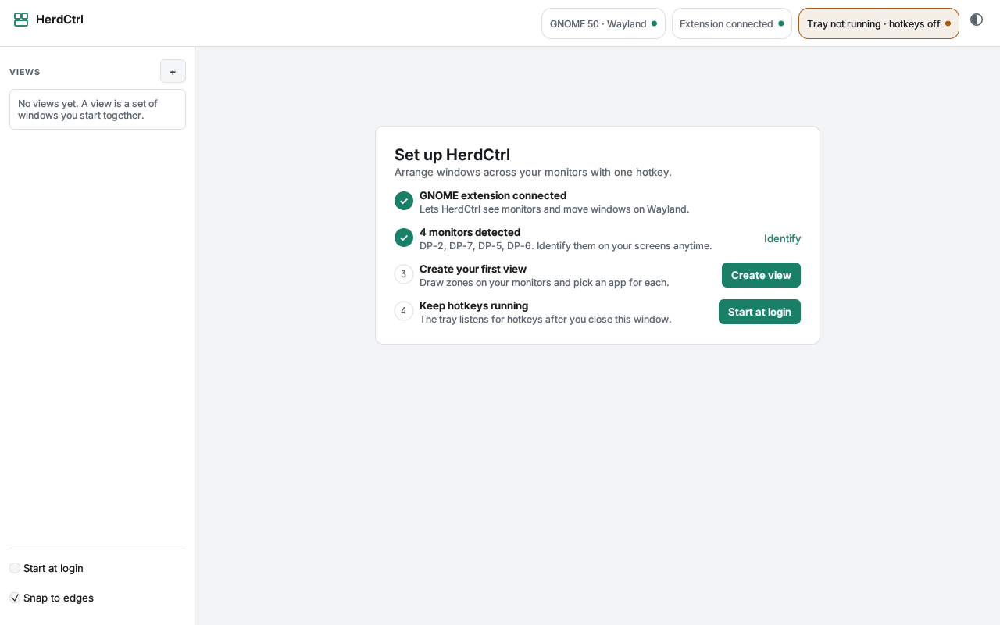
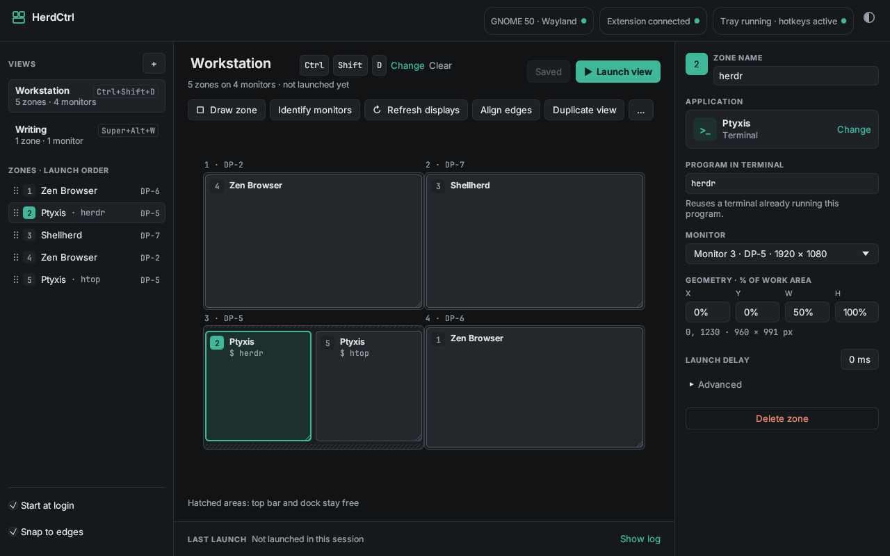
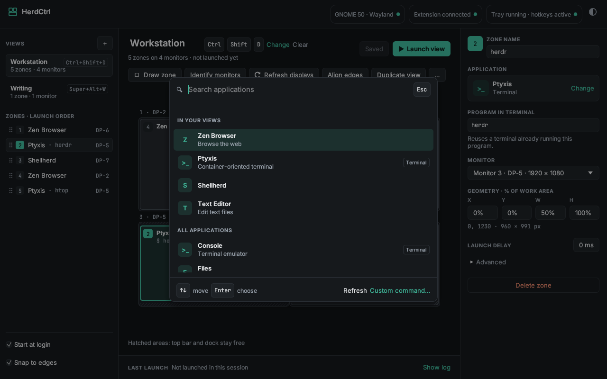
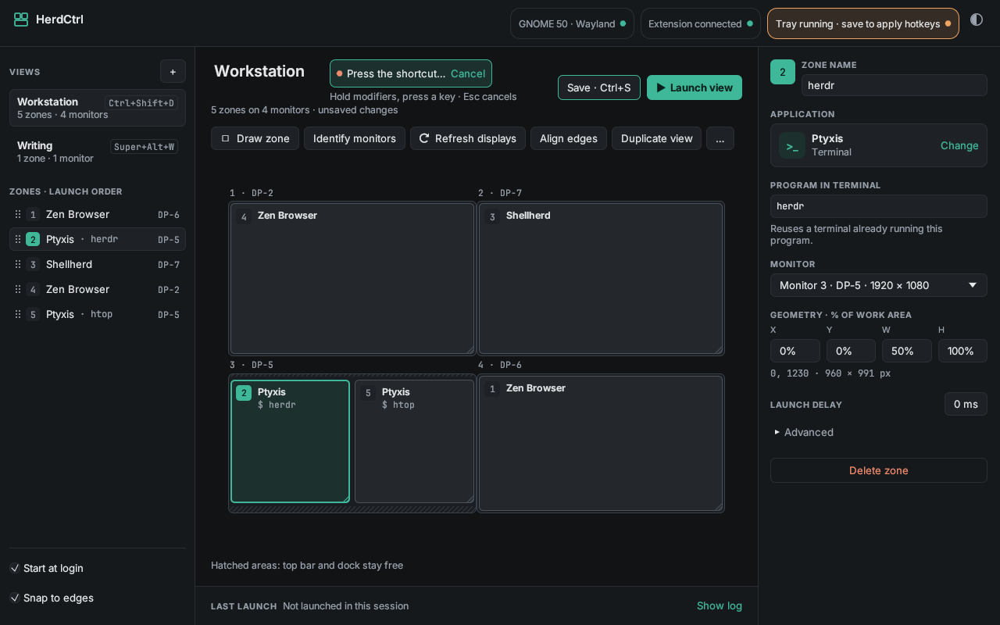
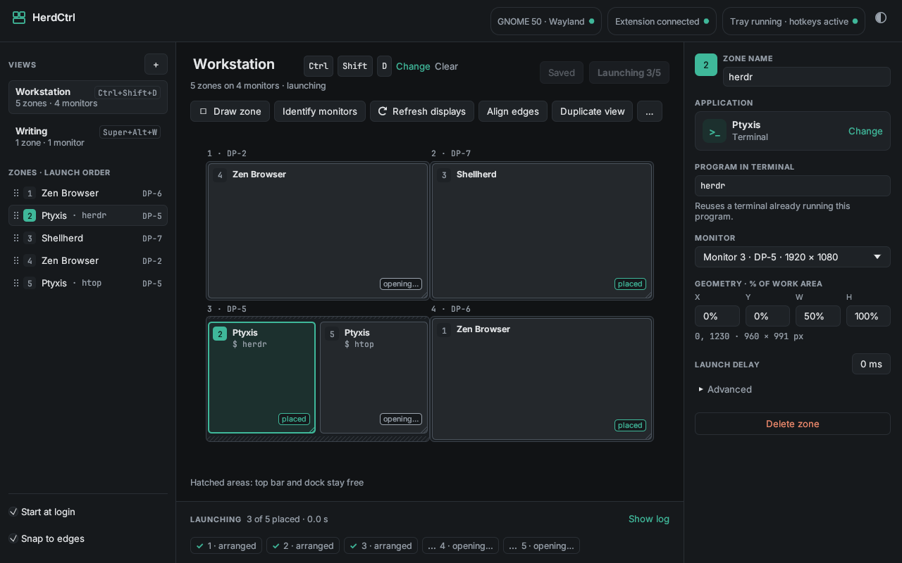
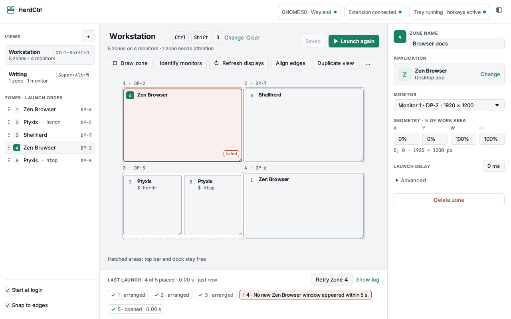
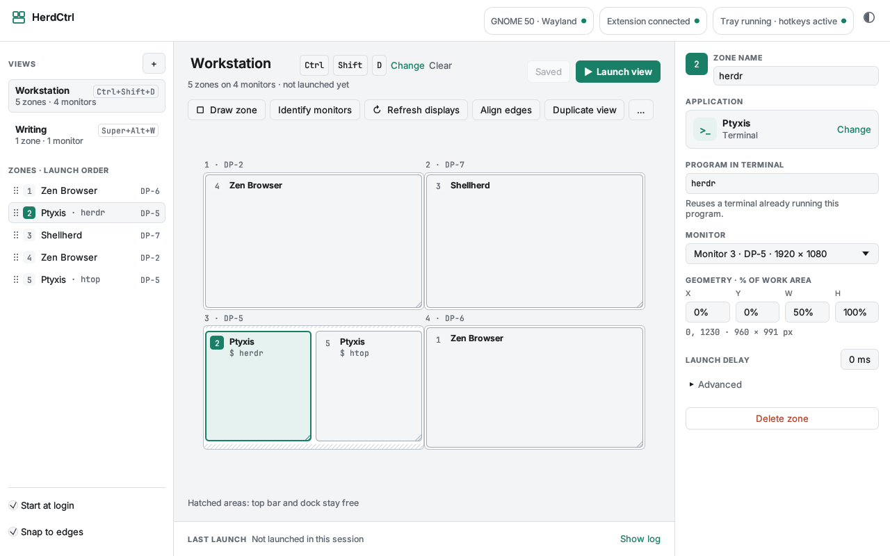

# HerdCtrl – User guide


Complete description of HerdCtrl. The short overview is in the [README](../README.md). Deutsche Fassung: [handbuch.md](handbuch.md).

HerdCtrl arranges application windows into named **views**. A view is a set of **zones** drawn on your monitors. Each zone holds one application, a program in a terminal, or a custom command. Launching a view, by button, tray menu or global hotkey, starts what is missing and moves every window into its zone.

- [Installation](#installation)
- [First start](#first-start)
- [The editor](#the-editor)
- [Views](#views)
- [Zones](#zones)
- [Applications, terminals and commands](#applications-terminals-and-commands)
- [Monitors](#monitors)
- [Global hotkeys](#global-hotkeys)
- [Launching a view](#launching-a-view)
- [Tray](#tray)
- [Appearance](#appearance)
- [Files](#files)
- [Limitations](#limitations)
- [Troubleshooting](#troubleshooting)
- [Development](#development)

## Installation

### Supported sessions

| Session | Window control | Monitor data | Hotkeys |
|---|---|---|---|
| Ubuntu **X11**, EWMH window manager | `wmctrl` | `xrandr --verbose` | X11 key grabs (physical key codes) |
| **GNOME 50 on Wayland** | HerdCtrl Shell extension (Mutter API) | Extension: connectors, logical rectangles, scale, work area | Compositor grabs through the extension (current keyboard layout) |

Other Wayland compositors are detected and reported as **Wayland · unsupported**. HerdCtrl never routes Wayland window control through `wmctrl`.

The editor itself runs through X11 or XWayland. On GNOME this does not limit which windows it can control: native Wayland and XWayland windows are both supported.

### Renderer

The editor draws with **Vulkan** (wgpu) and lets the Vulkan loader open only the driver of the **primary GPU** (the one the firmware booted on, from `/sys/class/drm`). That avoids loading LLVM, which Mesa's OpenGL driver and the lavapipe software driver need, and keeps the editor at 29 to 31 MB instead of about 85 MB. On laptops with a second, discrete GPU, that GPU stays asleep.

- If no Vulkan device works, the editor restarts itself with **OpenGL** and prints *Vulkan renderer unavailable (…); using OpenGL*. This happens in virtual machines and on old GPUs, and costs one extra start.
- To force OpenGL, start it with `HERDCTRL_RENDERER=glow`. Do the same if the window shows drawing errors or the editor crashes after a GPU reset.
- A driver choice you set yourself is left alone: `VK_LOADER_DRIVERS_SELECT`, `VK_LOADER_DRIVERS_DISABLE`, `VK_ICD_FILENAMES`, `VK_DRIVER_FILES` or `VK_ADD_DRIVER_FILES`. Use `VK_LOADER_DRIVERS_SELECT` to make the editor draw on another GPU.
- The variables HerdCtrl sets for its own window are removed again for every program it starts, so your apps see all drivers as usual.
- The monitor identification labels always use OpenGL; they are open for a few seconds only.

### Build

Install a stable Rust toolchain with [rustup](https://rustup.rs), then:

```sh
sudo apt-get install build-essential pkg-config libx11-dev libxi-dev libxcursor-dev \
  libxrandr-dev libxkbcommon-dev libxkbcommon-x11-0 libxcb-xkb1 libgl1-mesa-dev \
  libvulkan1 mesa-vulkan-drivers wmctrl x11-xserver-utils
cargo build --release --locked
./target/release/herdctrl
```

The result is a single executable, `target/release/herdctrl`. Copy it somewhere on your `PATH` (for example `~/.local/bin`) if you want the tray's **Start at login** and **Edit layouts…** to keep working after you rebuild in another directory. Both use the path of the running executable.

X11 needs `xrandr`, `wmctrl` and GNU `timeout` at runtime. A desktop entry and themed icons are prepared in `assets/HerdCtrl-Iconset/linux/`.

### Verify a download

Release files are built and signed by the workflow `.github/workflows/release.yml` on GitHub, never on a developer machine. There is no stored signing key: [Sigstore](https://www.sigstore.dev) records the workflow's GitHub identity in a public transparency log. Each release contains `SHA256SUMS`, its signature bundle `SHA256SUMS.sigstore.json`, the program archive and the extension ZIP.

Check the signature with [cosign](https://docs.sigstore.dev/cosign/system_config/installation/), then the files (replace `v0.1.0` with the release):

```sh
cosign verify-blob --bundle SHA256SUMS.sigstore.json \
  --certificate-identity https://github.com/pelmenipower/HerdCtrl/.github/workflows/release.yml@refs/tags/v0.1.0 \
  --certificate-oidc-issuer https://token.actions.githubusercontent.com \
  SHA256SUMS
sha256sum --check --ignore-missing SHA256SUMS
```

Alternatively, `gh attestation verify herdctrl-v0.1.0-linux-x86_64.tar.gz --repo pelmenipower/HerdCtrl` checks GitHub's build attestation. Linux does not warn about unsigned programs on start, so these checks are the way to make sure a download is genuine. Windows builds and their code signing are not available yet.

### GNOME 50 extension

On GNOME/Wayland, HerdCtrl talks to its own Shell extension over the session D-Bus. Install it once from the repository:

```sh
bash scripts/install-gnome-extension.sh
```

This uses GNOME's own installer for your user. If GNOME does not know the extension yet, log out and back in, then:

```sh
gnome-extensions enable herdctrl@herdctrl.local
```

After updating an extension that is already loaded, log out and back in again; GNOME only loads extension code at login. In the editor, **Refresh displays** re-reads the monitors. The header should show **GNOME 50 · Wayland** and **Extension connected**.

A read-only diagnostic prints what the extension reports:

```sh
python3 scripts/check-gnome.py
```

It needs `gdbus` (package `libglib2.0-bin`). To build the extension ZIP separately, run `python3 scripts/package-gnome-extension.py`. It is written to `target/herdctrl@herdctrl.local.shell-extension.zip`.

GNOME 50 is the compatibility target. Other GNOME versions need their own verification.

### Tray icon

The tray uses the StatusNotifierItem protocol. GNOME shows it only with the AppIndicator extension (`ubuntu-appindicators@ubuntu.com`, enabled by default on Ubuntu). Without a tray host, hotkeys keep working, but the icon is hidden. It appears as soon as a host becomes available, for example after unlocking the screen.

## First start



Without views, the editor shows a short checklist:

1. **GNOME extension connected** (only on GNOME): whether the extension answers.
2. **Monitors detected**: the connector names. **Identify** shows their numbers on the screens.
3. **Create your first view**: **Create view** adds an empty view.
4. **Keep hotkeys running**: **Start at login** adds the tray to your session's autostart.

## The editor



| Area | Content |
|---|---|
| **Header** | Session (`X11`, `GNOME 50 · Wayland`), extension state and tray state. Click a stopped tray's pill to start it. The round icon at the right switches the appearance. |
| **Sidebar** | All views with their hotkeys, **+** for a new view, and the zones of the selected view in launch order. Below that, **Start at login** and **Snap to edges**. |
| **Canvas** | Your monitors to scale, with number and connector above each one. Hatched strips are panels and docks that zones leave free. |
| **Properties** | The selected zone: name, application, program in terminal, monitor, geometry, launch delay and **Advanced**. |
| **Last launch** | Result of the last launch per zone, with **Retry zone** and **Show log**. |

**Ctrl+S** saves. Closing the editor with unsaved changes offers **Save and close**, **Discard** and **Cancel**.

Only one editor runs per layouts file. Starting `herdctrl` a second time exits with *The HerdCtrl editor is already open*.

## Views

- **+** in the sidebar creates a view. The name is edited in place in the title.
- **Duplicate view** copies the selected view without its hotkey, because a hotkey can only belong to one view.
- **…** → **Delete view** asks for confirmation. The deletion takes effect when you save.
- The line below the title summarizes the view: zones, monitors and launch state.

## Zones

### Draw, move, resize

1. Select **Draw zone**, then drag a rectangle on a monitor. The application picker opens.
2. Drag a zone to move it. Drop it on another monitor to transfer it: it keeps its relative size and application, takes over the new monitor and snaps into free space there. If the destination is full, the zone stays at its last valid position. **Escape** during a drag restores the original monitor and size.
3. Resize with the grip at the bottom right.
4. Drag zones in the sidebar to change their **launch order**. The number on each zone is its position in that order.

### Snapping and overlaps

**Snap to edges** is on by default. Drawing, moving and resizing dock to screen borders, halves, thirds, quarters and the edges of neighbouring zones while avoiding overlaps. Guides show where a zone will snap.

**Align edges** tidies zones that were placed imprecisely. Overlapping zones are highlighted and explained instead of being rewritten silently; very crowded layouts may need manual resizing. Turn snapping off for free placement.

### Properties

| Field | Meaning |
|---|---|
| **Zone name** | Free label, shown in the log and notifications. |
| **Application** | The desktop app. **Change** opens the picker. |
| **Program in terminal** | Only for terminal apps: the program to run inside, for example `herdr`. |
| **Monitor** | Target monitor by number, connector and resolution. |
| **Geometry** | X, Y, width and height in percent of the monitor's **work area**, with the resulting pixels below. |
| **Launch delay** | Milliseconds to wait before starting this zone, for apps that need time. |
| **Advanced** | **Custom command** and **Run in terminal**. |
| **Delete zone** | Removes the zone from the view. |

Zones are stored as fractions (0.0 to 1.0) of their monitor, so they follow resolution and scale changes.

## Applications, terminals and commands

### Application picker



The picker lists the installed desktop applications of your user and the system, with localized names. Apps that one of your views already uses come first, and terminal apps are marked **Terminal**. Type to search, move with **↑↓** and choose with **Enter**. **Refresh** reads the desktop entries again, and **Custom command…** opens the zone's advanced section instead.

The layout stores the app's ID and name, not its command line. At launch, HerdCtrl resolves the current executable from the desktop entry, so updates and moved installs keep working. A removed app produces a message asking you to choose another one.

Apps are started directly, without a shell. New Ptyxis and GNOME Text Editor windows are started with their independent-instance option so their windows can be matched reliably.

### Programs in a terminal

Choose a terminal app (for example **Ptyxis**) and enter the **Program in terminal**, for example `herdr` or `htop`. HerdCtrl opens the terminal and runs the program inside it via `sh -c`. A later launch finds the terminal that still runs this program and only moves it.

### Custom commands

**Advanced → Custom command** runs a command line through `sh -c` with your user's rights. It replaces the application selection. Only enter commands you trust.

- **Run in terminal** runs the command in your default terminal: the `xdg-terminal-exec` choice, otherwise the first installed of Ptyxis, GNOME Terminal, Console, Ghostty, Konsole, Alacritty, kitty, WezTerm and foot. Interactive programs need this.
- Alternatively, include the terminal yourself, for example `xterm -e htop`.
- For other programs, add a new-instance option if the program would otherwise only focus an existing window.

## Monitors

Monitor numbers follow the current arrangement, top to bottom and left to right. The caption above each preview shows number and connector; hover it for the resolution.

**Identify monitors** shows a large number on every screen for a few seconds. **Hide numbers** removes them early. Layouts store **connector names** (for example `DP-5`), not numbers, so plugging monitors in a different order does not move a saved zone to another screen.

**Refresh displays** reads the monitors again after you change the arrangement.

### Work area

On GNOME, zones fill each monitor's **work area**: the top bar and a fixed dock stay visible. The canvas shows the reserved strips hatched. This needs the extension from 2026-11-09 or later (log out and back in after updating). On X11 and with older extensions, zones use the whole monitor.

### Coordinates

- **X11:** geometry from `xrandr --verbose`, including negative offsets. The canvas shows the horizontal XRandR transform factor. Per-monitor toolkit scaling, non-uniform transforms and arbitrary rotation are not fully modelled.
- **GNOME:** logical monitor rectangles and scale from the compositor. Placement uses the same logical coordinates without multiplying by the scale again. Mirrored connectors share one logical monitor.
- A zone whose monitor is disconnected fails with a visible error instead of moving to another screen.

## Global hotkeys



1. Click **Record** (or **Change**) next to the view name.
2. Press the whole combination, for example hold **Super+Alt** and press **D**. At least one modifier (Super, Ctrl, Alt or Shift) is needed.
3. **Save**. The tray applies the new hotkeys within about a second, and the header says *save to apply hotkeys* until then.

**Escape** or **Cancel** stops recording, and so does clicking a text field. Unsupported keys show a hint. **Clear** removes the hotkey. The layout stores it as text, for example `Super+Alt+KeyD`.

Things to know:

- egui does not report the Super key on Linux, so the recorder asks the X server whether Super is held (the editor runs on X11/XWayland).
- A combination the desktop or the running tray already grabs never reaches the recorder. To record the current combination of a view again, clear it and save first.
- On GNOME, letter keys follow the current keyboard layout. X11 uses physical key codes.
- Conflicts with shortcuts the desktop already uses are reported as notifications.
- GNOME: up to 256 hotkeys. Grabs end when the tray quits. After a crash they expire within about 20 seconds, and disabling the extension releases them immediately.

## Launching a view



**Launch view**, the tray menu and the hotkey all start the same sequence. During a launch each zone on the canvas shows *opening…*, *placed* or *failed*. The panel below lists every zone:

| Result | Meaning |
|---|---|
| **arranged** | An existing window was moved into the zone. |
| **opened** | A new window was started and placed. |
| **failed** | With the reason, for example *No new Zen Browser window appeared within 5 s.* |



**Retry zone** launches only the zones that failed. **Show log** shows all messages. When launched from the tray, successful placements stay quiet, and errors arrive as desktop notifications.

### How windows are found

1. HerdCtrl first looks for an **open window** of the zone's application. It identifies apps by their own executable or desktop-entry process identity, never by window title. Shared interpreters such as `python` alone do not identify an app.
2. If several matching windows exist, it takes the lowest stable window ID that no other zone of this view has taken. Repeated launches therefore reuse the same windows.
3. If there is no free window, it starts the app and waits for a new window of that process or its children. Windows delegated to an already running process of the same app also count.
4. Apps that are already running are started through their desktop entry's **new-window action** when they have one. An app without that action usually only focuses its window; that zone then reports that no second window opened.
5. Before moving, the window's PID is checked again, so unrelated windows are never moved.

### Timing

- Each zone waits for its **launch delay**, then up to **5 seconds** for its window. Each helper call is limited to 2 seconds.
- A newly opened window is placed again 0.25, 0.75 and 1.75 seconds after the first placement, because apps such as Ptyxis (restore-window-size) or Zen apply their remembered size afterwards.
- All zones of the same application, including terminal zones, start one after another, so that each new window can be assigned to its zone. Each of them can take up to its delay plus 5 seconds.
- Complete view launches are queued: pressing the hotkey twice quickly does not start everything twice.
- Apps keep running if positioning times out.

Apps that update themselves (the running binary shows as *(deleted)*) are still recognized through the desktop entry they were launched from.

## Tray

`herdctrl --tray` is a small background process without an editor window or renderer. It owns the global hotkeys and shows an icon in the top bar.

| Menu item | Action |
|---|---|
| *View name (hotkey)* | Launches that view. |
| **Edit layouts…** | Opens the editor. |
| **Start at login** | Writes or removes `~/.config/autostart/herdctrl.desktop`. |
| **Quit HerdCtrl** | Ends the tray and releases the hotkeys. |

- Starting the editor also starts the tray if it is not running. Saving in the editor starts it again if you had quit it.
- The tray reloads `layouts.json` within about a second after it changes, also when you edit the file by hand.
- Only one tray runs per layouts file; a second one exits.
- Errors (launch failures, taken shortcuts, invalid configuration) appear as desktop notifications.

## Appearance

The round icon in the header switches between **System**, **Dark** and **Light**. With **System**, HerdCtrl reads the desktop's light/dark preference from the XDG settings portal at startup. The choice is stored in `~/.config/herdctrl/ui.json`.



## Files

| File | Content |
|---|---|
| `$XDG_CONFIG_HOME/herdctrl/layouts.json` (default `~/.config/herdctrl/layouts.json`) | All views, zones and hotkeys |
| `~/.config/herdctrl/ui.json` | Appearance |
| `~/.config/autostart/herdctrl.desktop` | Exists while **Start at login** is on |
| `$XDG_RUNTIME_DIR/herdctrl-{tray,editor}-<hash>.lock` | Single-instance locks for editor and tray, one pair per layouts file |

### layouts.json

```json
{
  "views": [
    {
      "name": "Workstation",
      "hotkey": "Super+Alt+KeyD",
      "zones": [
        {
          "name": "herdr",
          "monitor": "DP-5",
          "application": { "id": "org.gnome.Ptyxis", "name": "Ptyxis" },
          "terminal_command": "herdr",
          "delay_ms": 0,
          "bounds": { "x": 0.0, "y": 0.0, "width": 0.5, "height": 1.0 }
        },
        {
          "name": "Notes",
          "monitor": "DP-6",
          "command": "xterm -e vim ~/notes.md",
          "delay_ms": 500,
          "bounds": { "x": 0.5, "y": 0.0, "width": 0.5, "height": 1.0 }
        }
      ]
    }
  ]
}
```

| Field | Meaning |
|---|---|
| `hotkey` | Empty or `Modifier+…+Key` with key names such as `KeyD`, `Digit1` or `F10` |
| `monitor` | Connector name |
| `application` | Desktop entry ID and display name |
| `terminal_command` | Program inside a terminal app |
| `command` | Custom command (instead of `application`) |
| `run_in_terminal` | Run `command` in the default terminal |
| `delay_ms` | Launch delay |
| `bounds` | Fractions of the monitor's work area |

Unknown fields are rejected. Saving writes a private temporary file and renames it atomically. An invalid file stops the start with an error message instead of being overwritten. A leftover `layouts.json.tmp` after an interruption must be checked and removed before the next save.

## Limitations

- **Memory:** the editor needs 29 to 31 MB with the Vulkan renderer (measured on an Intel GPU; the PRD target of 30 MB is met only in some starts), and about 85 MB after a fallback to OpenGL. NVIDIA's own driver was not measured. On AMD GPUs the Vulkan driver itself links LLVM, so the editor needs more there. The tray, which keeps running, needs about 2 MB of its own memory. Details in [VALIDATION.md](../VALIDATION.md).
- Wrapper scripts, sandboxed apps and terminal servers that host every window in one process (GNOME Console, GNOME Terminal) cannot always be identified. HerdCtrl does not guess. It starts a new window, matches by launch order or reports a timeout.
- Mixing an application zone and a custom command for the **same program** in one view is not supported, because their windows cannot be told apart reliably.
- Window managers and apps can enforce minimum sizes or add decorations, so pixel-exact outer placement depends on the desktop.
- Very short-lived launcher processes may exit before HerdCtrl sees their children.
- Not yet verified: native Wayland absolute window origins, fractional scaling and monitor hot-plugging on GNOME.

## Troubleshooting

| Symptom | Fix |
|---|---|
| `Library libxkbcommon-x11.so could not be loaded` | Install `libxkbcommon-x11-0` and `libxcb-xkb1`. They are needed on Wayland too, because the editor runs through XWayland. |
| Header says **Displays unavailable** (hover it for the reason) | Install and enable the extension, log out and back in, then **Refresh displays**. Check with `python3 scripts/check-gnome.py`. |
| Header says **Wayland · unsupported** | Your compositor is not GNOME 50. Use an X11 session or GNOME 50. |
| Tray icon missing | Enable the AppIndicator extension. Hotkeys work without the icon. |
| Hotkey does nothing | Check the tray pill in the header, save after recording, and look for a conflict notification. The desktop may own the combination. |
| A zone keeps saying *No new … window appeared* | The app only focuses its existing window. Use one window per app, or a custom command with a new-window option. |
| Editor window stays empty, shows drawing errors or crashes | Start it with `HERDCTRL_RENDERER=glow` to use OpenGL, and report the GPU and driver. |
| Zones cover the top bar | Update the extension and log out and back in, so it reports the work area. |

## Development

The rules for contributors and coding agents are in [AGENTS.md](../AGENTS.md). The product requirements are in [PRD.md](../PRD.md), and measurements and acceptance results in [VALIDATION.md](../VALIDATION.md). The visual rules are in [design-system.md](design-system.md).

### Checks

```sh
cargo fmt --check
cargo clippy --all-targets --locked -- -D warnings
cargo test --locked
cargo build --release --locked
node scripts/gnome-controller.test.mjs
python3 scripts/package-gnome-extension.py
```

CI runs these on Ubuntu, plus a Rust↔GJS protocol round trip on an isolated D-Bus and the X11 integration under Xvfb and Openbox. The build artifacts (binary, extension ZIP, X11 measurement JSON) are uploaded. CI does not publish releases.

### UI tests and screenshots

`cargo test` drives the editor with simulated pointer and keyboard input through `egui_kittest`, without a GPU: adding a view, saving with Ctrl+S, deleting a view through its menu, and choosing an app with the arrow keys.

Two opt-in tests render the editor through a wgpu adapter with fixed sample data:

```sh
# All main states, dark and light, to target/ui-snapshots/
cargo test --locked render_ui_snapshots -- --ignored
# The README and manual gallery in docs/images/
cargo test --locked render_docs_screenshots -- --ignored
```

They do not compare against stored images. Review every regenerated image before committing it. Details in [images/README.md](images/README.md).

### X11 integration

On an X11 desktop:

```sh
sudo apt-get install xterm xdotool x11-utils
cargo test --locked x11_ -- --ignored --test-threads=1 --nocapture
cargo build --release --locked
python3 scripts/check-x11.py --output /tmp/herdctrl-x11-acceptance.json
```

The Rust tests open temporary terminals on each monitor and compare their client geometry (`xwininfo`) within 32 pixels. They also check that an unrelated window stays put, that the no-window timeout works, and that a disconnected target is rejected before anything starts. The Python check uses its own temporary configuration, presses `Ctrl+Alt+Shift+F10` while another window has focus, and records startup time and memory. Keep that shortcut free, and do not touch the test windows while it runs.

### GNOME live tests

Opt-in on a real GNOME 50 session. They need `python3-gi`, `gir1.2-gtk-4.0` and `x11-utils`, and they leave saved layouts unchanged:

```sh
HERDCTRL_LIVE_GNOME=1 cargo test --locked gnome_live_launch_and_resize_on_each_monitor -- --ignored --nocapture --test-threads=1
cargo build --release --locked
HERDCTRL_LIVE_GNOME=1 cargo test --locked gnome_live_identification_positions_and_cleans_up_labels -- --ignored --nocapture --test-threads=1
```

The first one opens temporary undecorated GTK windows on each monitor, both native Wayland and XWayland, and writes `target/gnome-live-acceptance.json`. The second one checks the monitor numbers.

### Measuring memory and start time

```sh
cargo build --release --locked
scripts/measure-rss.sh 5
```

The script starts the editor with a temporary configuration, waits for the window that belongs to its own PID, and reports the time to a visible window, VmRSS and RssAnon. `HERDCTRL_RENDERER=glow scripts/measure-rss.sh 5` measures the OpenGL fallback for comparison.

### Icon

The window icon is embedded from `assets/icon.png`, and `assets/icon.svg` is its source (`rsvg-convert -w 256 -h 256 assets/icon.svg -o assets/icon.png`). The complete icon set, including the hicolor folders and a desktop entry, is in `assets/HerdCtrl-Iconset/`.
